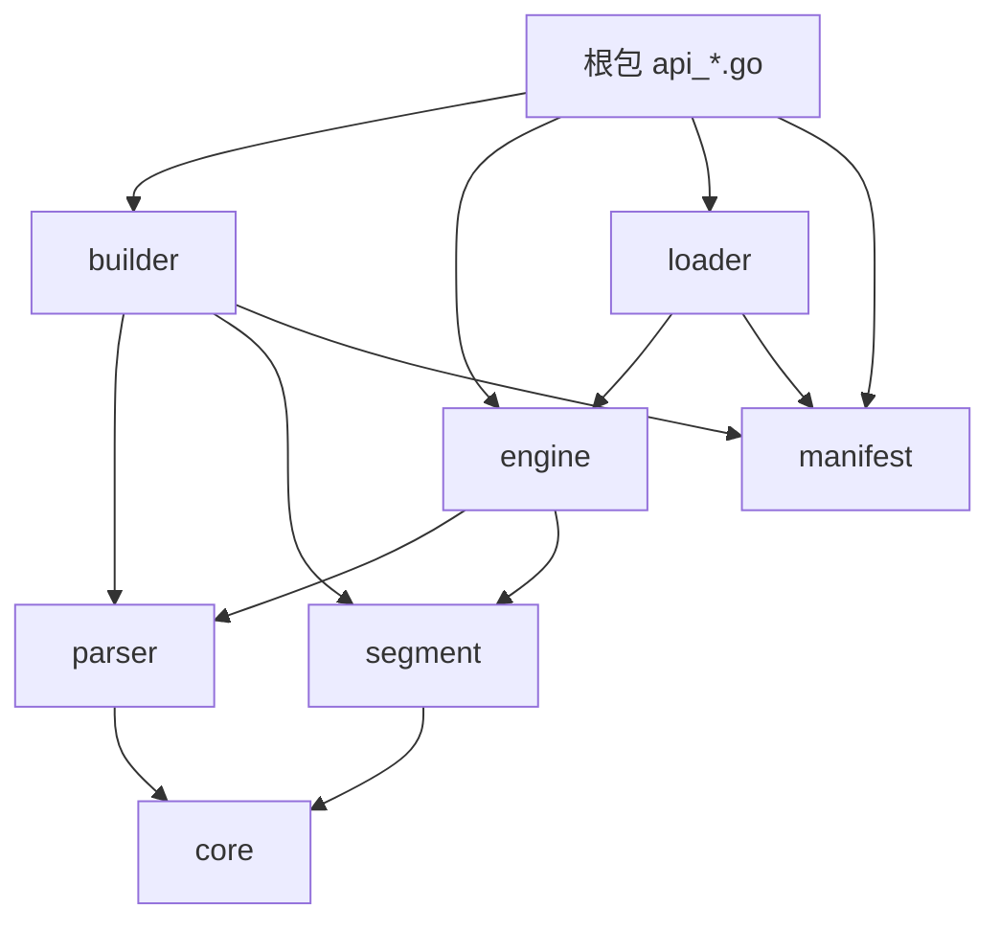

# 架构与实现

本文描述当前实现。设计目标依次为布尔语义正确、数据完整性与可靠生命周期，以及真实负载下的吞吐、延迟和内存表现。历史方案保留在 `docs/history`，不作为当前 API 规范。

## 1. 包边界与依赖



| 包 | 职责 |
|---|---|
| 根包 | 按 document/query/score/build/segment/snapshot 提供入口；`api_maintenance.go` 实现索引合并/重建的统计评估 |
| `builder` | Document 校验、编码、写入 Segment；full/delta 代构建及描述符 |
| `parser` | SchemaCodec、PredicateEncoder、ValueTokenizer；与物理段格式解耦 |
| `segment` | 布局、序列化、mmap/heap Reader、容器注册表、外排与校验 |
| `engine` | 基于 PostingIterator/FieldCursor 的布尔归并、collector 适配、full/delta 可见性与 Top K |
| `core` | 强类型 ID、规则模型、游标算法、集合、collector、评分原语 |
| `manifest` / `loader` | 不可变元数据、CURRENT 发布、快照加载、Holder 引用计数回收 |
| `container` | MPH/FST 等容器，以及 geo 等外部编码器 |

`builder` 与 `engine` 互不依赖，均使用 `parser` 和 `segment`；`parser` 不依赖 `segment`。注册在启动阶段完成，Reader/encoder 的查询实现必须支持并发调用。

根包的 [`api_maintenance.go`](../../api_maintenance.go) 根据 Manifest 元数据和业务传入的运行指标返回 `none` / `minor` / `major` 及原因，只供业务评估是否合并 delta、重建并发布 full；不参与查询，不执行构建、发布或任务调度。`TimeSinceFullBuild` 表示评估时距当前 full 构建完成经过的时间，由业务记录并传入。阈值和统计口径见 [API 参考](../guide/api-reference.md#索引合并与全量发布评估)。

## 2. 规则与 ID

Document 的 Conjunction 之间为 OR；Conjunction 的 Predicate 为 AND。同字段最多一个 Include Constraint，可有多个 Exclude。K 是 Include Constraint 数；同一个 Constraint 的多个等值为 OR。缺少 Include 字段不匹配；缺少 Exclude 字段不触发排除。

K=0 的 Conjunction 产生 wildcard（Z-Entry），始终进入候选，但匹配到的 Exclude 仍可否决。空 Conjunction 是无条件规则。

`Predicate` 将 `FieldName` 与 `Constraint` 绑定；`Conjunction.Constraints` 按字段保存约束。`FieldCount()` 统计字段键，`IncludeCount()` 统计包含 Include 的字段数，即合法规则中的 K。一个约束可以包含多个值，值的数量不增加 K。这与 [VLDB 09 论文](../../static/design/vldb09-indexing.pdf) 中用正向谓词数确定候选需要命中多少字段的含义一致。

```text
ConjID:
  reserved[63:60] | K[59:52] | index[51:44] | sign[43] | abs(DocID)[42:0]
EntryID = (ConjID << 4) | include
  K[63:56] | index[55:48] | sign[47] | abs(DocID)[46:4] | reserved[3:1] | include[0]
```

Exclude 的低位为 0，Include 为 1，同一 Conjunction 内 Exclude 在前。有效 DocID 范围为 `[-(2^43-1), 2^43-1]`；Conjunction 数和 K 均小于 256。EntryID 顺序是 K、index、sign、绝对 DocID、Include 位，不是 signed DocID 顺序或得分顺序。

EntryID 只编码 Conjunction 与 Include/Exclude 极性，同一个 EntryID 可出现在不同字段、不同 term 的 Posting List 中。`EntryID.ConjID()` 读取 ConjID，`ConjID.IncludeCount()` 读取 K；游标耗尽用独立哨兵 `EndEntryID` 表示。

## 3. 构建路径与生命周期

```text
Document → Normalize / Validate → SchemaCodec
         → PredicateEncoder.EncodeConstraint → EncodedRecord{Record}
         → SegmentBuilder.AddRecord(field, record, entries)
         → IndexBuilder.Build(BlockWriter) → Segment v5
```

- `BuildSegmentFromDocs` 处理单段内存输入；`BuildSegmentsFromDocs` 先做整个 corpus 的 DocID 唯一性校验，再分段。
- `FullIndexBuilder` 流式接收文档，跨段维护 DocID seen-set，默认启用外排。
- `DeltaIndexBuilder` 在内存收集 mutation，Build 时按 DocID/version 收敛，再输出段和 changed/deleted sidecar；同版本 Delete 优先。
- SegmentBuilder 是唯一段构建器；全内存和溢写配置输出相同字节。`MaxDistinctKeysInMemory` 是 distinct key 阈值，热点 posting、全局去重集、字典和 range 最终构建仍占内存。

`TmpDir` 是调用方的父目录，溢写 builder 用 `MkdirTemp` 创建独占 run 子目录。`Write()` 在成功、失败后都调用 Close；主动放弃也调用 Close。Close 幂等，只删除该私有目录，不关闭 writer，不删除调用方父目录。Full/Delta builder 在自己的临时代目录内构建，成功后原子 rename 到最终代；出错或提前 Close 清理临时代。

## 4. Segment v5 与端序

```text
Magic "BEIDX\0\0\5" (8 bytes)
  → 按字段写入的 blocks（起始位置按 8 bytes 对齐）
  → __wildcards block（BEIENT1 header + EntryID 数组）
  → MetaBlock JSON（字段、schema hash、block offset/size/checksum）
  → MetaOffset uint64 little-endian
```

默认/AC 等 term 容器使用独立 postings block，索引保存 `PostingRef{Offset, Count}`。range 容器在自身块中保存点表、树节点和 postings。各容器布局见 [索引文档](indexes/README.md)。

```text
FlatPostingList = Count uint32 LE | Pad uint32 = 0 | Count × EntryID uint64 LE
```

`mapLittleEndian` 是整数数组 unsafe 映射的统一边界：只有主机为 little-endian 且输入地址对齐时借用数组，其余情况逐项显式解码。posting、wildcard 和 AC 的 uint32 数组复用它。FlatDict/range 的部分元数据仍会分配 heap，因此整个 Reader 不承诺零拷贝。

Reader 借用字节或拥有 mmap；借用内容在生命周期内不可改写，mmap 文件也必须保持不可变。Reader Close 必须等待所有引用其数组/游标的查询结束。

### 打开时校验

所有模式都会校验结构；checksum 开关只控制 payload 哈希扫描：

- magic、版本、metadata 和 block 边界、schema hash、字段/块身份与重复定义；
- FlatDict 长度、偏移顺序与严格词典序；posting 引用长度、count 一致性与 padding；
- AC 状态结构、fail 链、output 引用，以及 output 到独立 postings block 的引用；
- range 点表顺序、posting 对齐与范围、树的 child 范围、叶子标记、split 范围，拒绝环、共享 child 和不可达节点；
- wildcard 块身份和编码结构。

range 验证使用迭代遍历，避免坏树导致递归栈溢出。检查不扫描每个 EntryID 的排序/语义。第三方容器仍负责其私有格式；`IndexValidator` 为跨块引用提供统一冷路径校验钩子，不能替代容器自身的安全实现。

验证元数据和引用会随字典/状态/节点规模增长；关闭哈希也不意味着常数时间冷启动。

## 5. 查询与 collector

```text
Assignments → 每字段 encoder.EncodeAssignment → []EncodedQuery{Value}
            → 预解析 ResolvedField.MatchQuery(IndexType, Value)
            → []PostingIterator → 每字段 FieldCursor
            → matchConjunctions → DocVisibilityMask → collector
```

查询初始化时把每段 wildcard 的 SliceIterator 放进单个 FieldCursor 懒归并，普通字段也把各段/各查询值的 posting 游标组合为 FieldCursor。构造引擎时预解析字段，热路径不重复查找字段映射。所有段在一次查询中串行组合和归并。

### K-Groups 归并

1. 按当前 EntryID 排序 FieldCursor，从最小头部读取 K，所需字段数为 `max(K,1)`。
2. 第 `max(K,1)` 个头部形成 pivot；不足 K 个字段的候选跳过。
3. 支持分数剪枝时，以 pivot 请求 `CompetitiveCollector.NextCandidate`。仅使用可证明不会漏掉赢家的跳转，并推进全部游标，包括 Exclude/wildcard。
4. 前若干头部属于同一 Conjunction 时，Include 经 DocVisibilityMask 后交给 collector；Exclude 命中则把相关游标推进到该 Conjunction 之后，不影响同 Document 的其他 OR 子句。
5. 用 SkipTo 推进，再用 `RemoveExhausted()` 移除排序后末尾的耗尽游标，直到耗尽或 collector 返回 CollectStop。

SkipTo 使用 galloping 加二分，在小步推进时减少搜索范围。K 直接从 EntryID 读取，不做物理 K 分桶。

### 统一 collector 契约

普通 collector 通过 `prepareCollector` 包装，得到每次查询唯一的可见 DocID。`DuplicateTolerantCollector.AcceptsDuplicates()` 为真则直接使用其自身去重，内置 bitmap 和 Top K 避免额外全量 seen-set。可选 `CompetitiveCollector` 能力单独保留，不通过具体 `*TopKCollector` 类型选择执行路径。

Collector 结果顺序未指定；调用方独占实例、复用前 Reset。CollectStop 在整次查询中生效，error 可能留下部分流式结果。Retrieve 返回独立拥有的 BitmapDocSet；collector.Bitmap 是借用视图。

### CompositeEngine

```text
Result = (FullResult − ChangedDocs) ∪ (可见 DeltaResults − DeletedDocs)
```

loader 已为较旧 delta 配置 DocVisibilityMask，屏蔽较新 delta 的 changed_docs。手动构造 IndexSnapshot 时由调用方保证此条件。

- `Retrieve` 逐层生成 bitmap，再批量 AndNot/Or。
- `RetrieveWithCollector` 逐层流式写入一个共享 collector：先过滤 ChangedDocs/DeletedDocs，再去重/消耗配额；CollectStop 阻止后续层执行。
- `RetrieveTopK` 使用同一 collector 路径，各层共享赢家和阈值。分数 source 在进入查询时固定为一个不可变快照。
- OnConjunctionMatch 是各 BooleanEngine 的诊断事件，发生在 Composite 过滤和最终去重之前，不是最终结果回调。

## 6. 发布、加载与回收

```text
index_root/
  CURRENT                          # manifests/manifest-<generation>.json
  manifests/manifest-*.json
  full/full-<generation>/segment-*.bei
  delta/delta-<generation>/segment-*.bei
                           changed_docs.bin
                           deleted_docs.bin
```

Full 与各 delta watermark 必须连续，schema hash 一致。Manifest 与代目录不可覆盖；`PublishManifest` 创建新 manifest 并原子切换 CURRENT，`PublishCurrent` 可指向已经发布的旧代。

业务推荐每个服务快照使用一个 full 和一个累计 delta，各自可包含多个 segment。delta 覆盖 `Full.SnapshotWatermark` 之后至本次截止位置的全部变更，每次发布替换旧 delta。底层仍支持多个连续 delta，其版本屏蔽语义保持不变。构建和发布流程见 [最佳实践](../guide/best-practices.md#10-索引合并与全量发布评估)。

| 加载模式 | 校验 |
|---|---|
| HeapVerify | 读入 heap、核对大小与整文件 SHA-256 |
| MmapVerify（默认） | 同一文件句柄核对大小与整文件 SHA-256 后 mmap |
| MmapTrustPublished | 核对大小并 mmap，保留结构校验、跳过 payload 哈希 |

加载遵循临时拥有、成功移交：任一步失败，关闭已经创建的 Engine/Reader。Holder 每次 Reload 只读取一次 CURRENT；引用未变则 no-op；新快照完成后原子发布。旧快照 retire，等待最后一个在途查询 release 后关闭 mmap。读取旧快照失败不影响当前服务。

## 7. 性能与验证边界

- 完整 Retrieve 有编码、游标和结果分配；核心 SkipTo/归并循环避免额外分配，使用 benchmark 跟踪实际开销。
- 增加段数会增加串行归并成本，不会自动增加单查询并行度。并发查询可以利用多核。
- 外排控制部分构建峰值，不等同于严格内存上限；需用真实热点分布和 range 数据测 RSS。
- 验证包括 GoConvey 回归、与原始 Document 求值的 Oracle shadow、race、坏 Reader 输入 fuzz，以及端序解码/对齐测试。
- 交叉编译只能检查目标架构可编译；big-endian 真实运行仍应在对应机器或模拟器进行。
